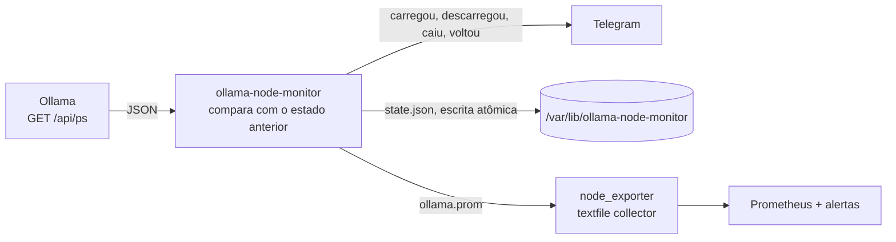

# ollama-node-monitor

[](https://github.com/BigLeno/ollama-node-monitor/actions/workflows/ci.yml)


Monitor leve para servidores com [Ollama](https://ollama.com): avisa no **Telegram** quando modelos são
carregados ou descarregados da memória, quando a API cai e quando volta, e exporta **métricas para o
Prometheus**. Roda como serviço **systemd** endurecido ou em **container**, em qualquer Linux, inclusive
em containers LXC do Proxmox, onde identifica o CTID sozinho.

```
🟢 Modelo carregado                       🔴 Modelo descarregado
📌 qwen2.5:7b · 7.6B · Q4_K_M             📌 llama3.2:3b
📦 5.6 GB · 40%/60% CPU/GPU               🖥️ gpu-01 (CT 105)
⏳ Descarrega em: 2026-11-04T20:06:00-03:00
🖥️ gpu-01 (CT 105)
```

## Como funciona



A cada intervalo, o monitor consulta a API HTTP do Ollama (`/api/ps`), compara os modelos carregados
com a verificação anterior e avisa só o que mudou. Ele acompanha vários modelos ao mesmo tempo.

- **Sem ruído:** na primeira execução manda um único "monitor iniciado" com o que já está carregado. A
  queda da API é avisada uma vez, e a volta também.
- **Resiliente:** se o Telegram falhar, tenta de novo e segue monitorando. O estado é gravado com escrita
  atômica, e um estado corrompido é tratado como primeira execução.
- **Seguro:** o token nunca vai para o log. O serviço roda sem privilégios, e o arquivo de configuração
  fica com permissão `600`.

## Instalação

Dependências: `bash` 4.4+, `curl` e `jq`.

### Como serviço systemd

```bash
git clone https://github.com/BigLeno/ollama-node-monitor.git
cd ollama-node-monitor
sudo make install                                   # binário, configuração e unit
sudo nano /etc/ollama-node-monitor/config.env       # token e chat do Telegram
sudo systemctl daemon-reload
sudo systemctl enable --now ollama-node-monitor
journalctl -u ollama-node-monitor -f
```

A unit usa `DynamicUser` (usuário temporário sem privilégios), `ProtectSystem=strict`,
`NoNewPrivileges`, filtro de famílias de rede e outras proteções. A configuração é lida pelo systemd
(`EnvironmentFile`) antes de o processo perder privilégios.

### Com Docker

```bash
cp config.env.example .env      # preencha o Telegram
docker compose up -d            # Ollama + monitor
docker compose exec ollama ollama run llama3.2:1b "olá"
```

A imagem é baseada em Alpine, roda com usuário sem privilégios e é publicada no GitHub Container Registry
a cada merge na `main`:

```bash
docker run -d --network host --env-file .env ghcr.io/bigleno/ollama-node-monitor:latest
```

### Uma verificação só (cron, scripts)

```bash
ollama-node-monitor --once --config ./config.env
```

## Configuração

| Variável | Padrão | Descrição |
| --- | --- | --- |
| `OLLAMA_URL` | `http://127.0.0.1:11434` | Endereço da API do Ollama |
| `POLL_INTERVAL` | `30` | Segundos entre verificações |
| `TELEGRAM_BOT_TOKEN` / `TELEGRAM_CHAT_ID` | vazio | Bot e chat do Telegram; vazios, as mensagens só vão para o log |
| `NODE_NAME` | hostname | Nome do nó nas mensagens e métricas |
| `METRICS_FILE` | vazio | Arquivo `.prom` para o textfile collector do node_exporter |
| `NOTIFY_API_DOWN` | `true` | Avisar quando a API cair e voltar |
| `PROXMOX_CTID` | detectado | CTID do container LXC no Proxmox |
| `STATE_DIR` | `/var/lib/ollama-node-monitor` | Onde fica o estado entre verificações |

## Métricas

Com `METRICS_FILE` apontando para a pasta do textfile collector do node_exporter:

| Métrica | Descrição |
| --- | --- |
| `ollama_up` | 1 se a API respondeu na última verificação |
| `ollama_models_loaded` | Quantidade de modelos em memória |
| `ollama_model_size_bytes{model}` | Memória usada por modelo |
| `ollama_model_vram_bytes{model}` | Parte do modelo na GPU |
| `ollama_monitor_last_poll_timestamp_seconds` | Última verificação (para detectar o monitor parado) |

Há regras de alerta prontas em [`deploy/prometheus/alerts.yml`](deploy/prometheus/alerts.yml): Ollama
fora do ar, monitor parado e modelo rodando parcialmente na CPU por falta de VRAM.

## Testes e CI

```bash
make lint   # shellcheck
make test   # bats: 20 testes de unidade e 5 de integração
```

Os testes de integração rodam o monitor de verdade (curl, jq, arquivos) contra um servidor falso que imita
a API do Ollama e a do Telegram.

| Job | O que valida |
| --- | --- |
| `lint` | shellcheck no script e nos testes, hadolint no Dockerfile |
| `unit` | Testes de unidade no bash 4.4, 5.1 e 5.2 |
| `integration` | Fluxo completo contra o servidor falso |
| `systemd` | `make install` num runner real, `systemd-analyze verify`, sobe o serviço e confere avisos, estado e que o token não vaza no journal |
| `docker` | Build, smoke test do container, usuário sem privilégios e publicação no GHCR |

## Licença

[MIT](LICENSE)
